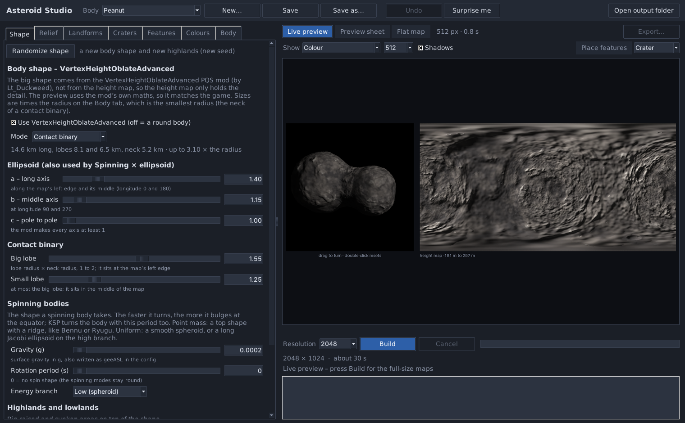
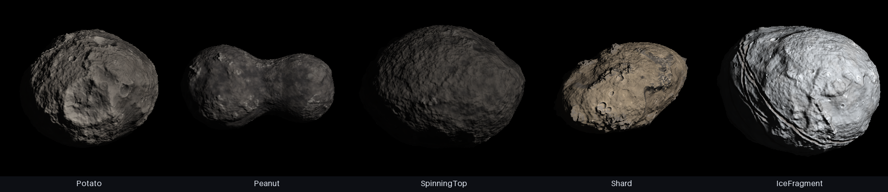

# Asteroid Studio



Asteroid Studio makes small, irregular bodies for Kerbal Space Program planet mods
(Kopernicus): potato-shaped asteroids, long shards, contact binaries and spinning tops.
It makes a height map, a colour map and a normal map that fit together, plus a Kopernicus
config with everything filled in.

The big shape comes from the
[VertexHeightOblateAdvanced](https://github.com/jamespglaze/VertexHeightOblateAdvanced)
PQS mod by Lt_Duckweed. The height map only adds the detail on top: hills, craters, grooves
and so on. The preview uses the mod's own maths, so what you see is the shape KSP builds.

It is a fork of Terra Studio, the sister program of Gas Giant Studio, and works the same
way.



## Download and start

**Windows:** download `AsteroidStudio-<version>-windows-x64.zip`, unzip it anywhere and
start `AsteroidStudio.exe`. You don't need to install Python.

**From source (any system):** install Python 3.9 or newer, then

```
pip install numpy pillow
python asteroid_ui.py
```

On Windows you can also double-click `Run Asteroid Studio.bat`. It installs numpy and
Pillow the first time.

**In KSP** the body needs Kopernicus and
[VertexHeightOblateAdvanced](https://spacedock.info/mod/3543/VertexHeightOblateAdvanced)
(MIT licensed; planet packs may bundle it).

## The shape

The **Shape** tab picks one of the mod's modes. Every size is a multiple of the radius on
the **Body** tab, and that radius is the smallest one: the short axis of an ellipsoid, the
pole of a spinning body, or the neck of a contact binary.

| Mode | oblateMode | Settings | Shape |
|---|---|---|---|
| Ellipsoid | `CustomEllipsoid` | a, b, c (1 or more) | a potato or a shard; a lies along longitude 0 and 180, b along 90 and 270, c pole to pole |
| Contact binary | `ContactBinary` | big lobe, small lobe (1 to 2 × the neck) | two round lobes joined by a smooth neck; the big lobe is at the map's left edge, the small one in the middle |
| Spinning (point mass) | `PointEquipotential` | gravity, rotation period | a top shape that bulges at the equator, up to 1.5 × the radius |
| Spinning (uniform) | `UniformEquipotential` | gravity, rotation period, energy branch | a smooth spheroid (Low), or a long Jacobi ellipsoid (High) |
| Spinning × ellipsoid | `Blend` | gravity, rotation period, a, b, c | the spinning shape times the ellipsoid |

The tab only shows the settings of the mode you pick. The gravity is also on the **Body** tab,
because it goes into the config for every mode. The spinning modes need a gravity and a period; until they have both, the mod (and the
preview) keeps the body round. The tab shows the size in km and how far out the shape
reaches.

Everything else follows the real surface, not the sphere underneath it:

- **Noise** is laid out on the real surface, so hills and roughness are as big on the
  tips of a long body as on its waist.
- **Craters** are spread evenly per km² of real surface, and a crater is as wide in km
  wherever it lands. The same goes for the domes, mountains and plateaus you place.
- **Rock on steep slopes** is measured against the shape, so the steep sides of a contact
  binary's lobes don't all turn to rock.
- **The normal map** uses the real distance between pixels, which is larger at the tips.

## What else it can do

- **Highlands and lowlands:** big raised and sunken areas on top of the shape.
- **Relief:** the height range of the detail in metres, mountains, hills, flat plains,
  fine roughness, and how strong the relief looks in the normal map.
- **Landforms:** plateaus, long troughs, grooves and cracks (crossing lines like the
  grooves on Phobos, or polygon cells), and domes.
- **Craters:** count, smallest and largest size, the mix of small and big ones, depth, age,
  bright ejecta and ray streaks.
- **Features:** your own craters, basins, domes, mountains and plateaus exactly where you
  want them. Turn on **Place features**, pick the kind and click the flat map or the body.
  Drag to move, right-click to remove.
- **Colours:** a colour for each height, height blur, patches, rock on steep slopes,
  frost, crater floor and ejecta colours, groove colour, brightness, contrast and
  saturation. The colour picker has an eyedropper and can take colours from a picture.
- **Live preview:** the body in 3D with its real outline and shadows, and the flat map,
  updated by itself after every change. Drag the body to turn it, double-click to reset it.
  Move the mouse over it to read the latitude, longitude, height, altitude and distance
  from the centre. **Shadows** turns the shadows off if your PC is slow.
- **Randomize:** every tab has its own Randomize button, **Surprise me** randomizes
  everything, and **Undo** (or Ctrl+Z) goes back.
- **Sizes:** 512, 1024, 2048, 4096 and 8192 pixels wide.

## Export

**Build** makes the full-size maps in `out/<body>/`. **Export...** writes the game files from
a build: you choose the folder, the file names, the formats and the size.

| File | Formats | In Kopernicus |
|---|---|---|
| Height map | DDS L8 (8-bit greyscale), PNG 16-bit or 8-bit | `VertexHeightMap` |
| Fine height map | DDS L8 | a second `VertexHeightMap` |
| Colour map | DDS BC1/DXT1, BC3/DXT5, BC7, PNG, JPG, TGA, BMP | `VertexColorMap` and the `ScaledVersion` texture |
| Normal map | DDS DXT5nm or BC5, PNG | `ScaledVersion` normals |
| Preview sheet | PNG, JPG | |
| Kopernicus config | .cfg | paste its nodes into your body's `Body` |

The config has the radius, the gravity, time warp heights that start above the highest
point of the shape, both height maps, the VertexHeightOblateAdvanced node and the textures:

```
Properties
{
	radius = 2600
	geeASL = 0.0002
	timewarpAltitudeLimits = 0 6300 6300 12600 25200 50400 100800 201600
}
PQS
{
	Mods
	{
		VertexHeightMap
		{
			map = MyMod/Textures/Peanut_height.dds
			offset = -183.6
			deformity = 471.3
			scaleDeformityByRadius = false
			order = 20
			enabled = true
		}
		VertexHeightMap
		{
			map = MyMod/Textures/Peanut_heightfine.dds
			offset = 0
			deformity = 1.85
			scaleDeformityByRadius = false
			order = 21
			enabled = true
		}
		VertexHeightOblateAdvanced
		{
			oblateMode = ContactBinary
			primaryRadius = 1.55
			secondaryRadius = 1.25
			order = 25
			enabled = true
		}
		VertexColorMap
		{
			map = MyMod/Textures/Peanut_color.dds
			order = 9999993
			enabled = true
		}
	}
}
ScaledVersion
{
	Material
	{
		texture = MyMod/Textures/Peanut_color.dds
		normals = MyMod/Textures/Peanut_normal.dds
	}
}
```

The spinning modes also get `rotationPeriod`, so the body turns at the speed that gave it
its shape.

Things to know in game:

- VertexHeightOblateAdvanced adds its height to the others, so the order of the mods
  doesn't matter.
- KSP's altitude is measured from the radius, so on the tips of a long body the ground can
  be several km "above sea level". The time warp heights in the config allow for that.
- Gravity in KSP always pulls towards the centre. On the side of a lobe the ground can be
  steep against that, even where it looks flat.
- Kopernicus builds the map view model from the PQS and caches it. **After changing the
  shape, delete the body's cache file** (the `cacheFile` in its Body, or its file in your
  mod's cache folder), or the map view keeps the old shape.
- The mod adds two camera modes after FREE (Surface Normal and Gravity Normal) when you
  are near the body.

**Path in config** in the export window is the folder under `GameData` the texture paths
in the config start with, for example `MyMod/Textures`. It fills itself in when you export
straight into a folder inside `GameData`.

An 8-bit height map only has 256 steps. The fine height map holds what falls between the
steps, so the two together are as smooth as a 16-bit map.

| Map | Format | When |
|---|---|---|
| Height, fine height | L8 | what Kopernicus' `VertexHeightMap` reads |
| Colour | BC1 / DXT1 | the default; what KSP uses out of the box |
| Colour | BC7 | best quality, twice the file size |
| Colour | BC3 / DXT5 | when you need an alpha channel |
| Normal | DXT5nm | the default; for KSP's own planet shaders |
| Normal | BC5 | for shaders that ask for a BC5 normal map |

BC5 and BC7 need a texture loader that can read them, such as KSPTextureLoader. DDS files
are flipped upside down on export, because KSP expects that.

## Presets

Every body is one small JSON file in `presets/`. Five examples come with it:

| Preset | Look |
|---|---|
| Potato | a 32 km ellipsoid with one big crater, like Phobos |
| Peanut | a 15 km contact binary, dark and cometary |
| SpinningTop | a 5 km rubble pile spun into a top shape |
| Shard | a long, tan 29 km shard with sharp ridges |
| IceFragment | a bright icy chunk crossed by grooves |

**New...** starts a body as a copy of the one you have open, with a new seed.

## Command line

```
python asteroid.py make Potato --res 4096
python asteroid.py export Potato --to export --res 4096 --config --config-path MyMod/Textures
python asteroid.py new MyRock --template Peanut
```

`export` options: `--height dds|png|png8|none`, `--fine dds|png|none`,
`--color dds|bc1|bc3|bc7|png|jpg|tga|bmp|none`, `--normal dds|bc5|png|none`,
`--preview png|jpg|none`, `--config`, `--config-path PATH`, `--size 2048`, `--no-flip`.

With the Windows download, use `AsteroidStudio.exe` in place of `python asteroid.py`.

## Requirements

- Python 3.9 or newer with numpy and Pillow 11.2 or newer (only when you run it from source)
- About 1 GB of free memory for a 4096 build, about 3 GB for 8192

## Building the Windows version

Double-click `build_release.bat`. It makes its own Python environment in `.buildenv`,
installs numpy, Pillow and PyInstaller there, builds `AsteroidStudio.exe`, tests it with a
small build and zips it to `release/AsteroidStudio-<version>-windows-x64.zip`.

## Credits

The shape maths is a Python port of VertexHeightOblateAdvanced by Lt_Duckweed (MIT
License); see `THIRD_PARTY_NOTICES.md`.
